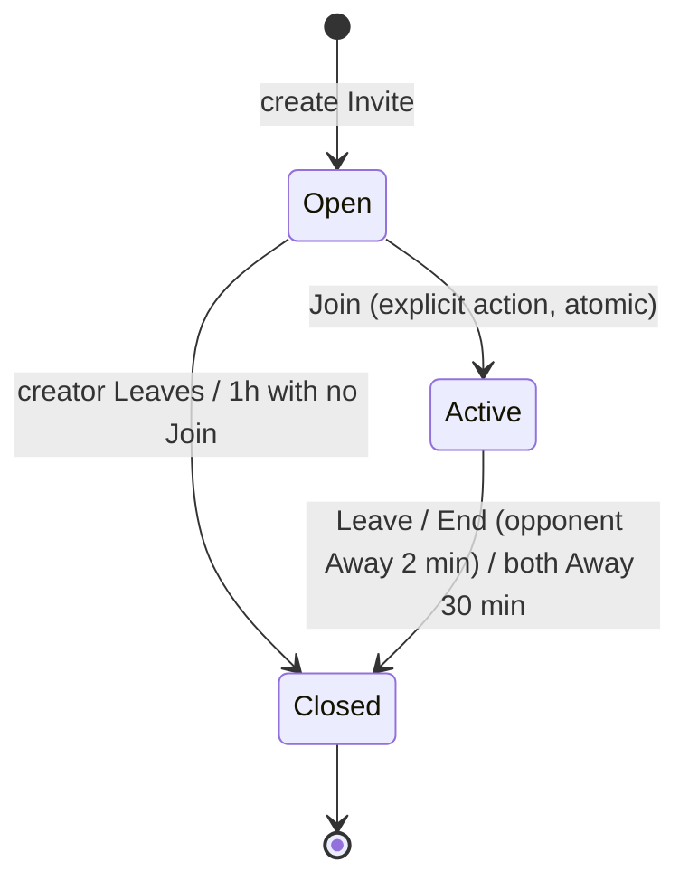
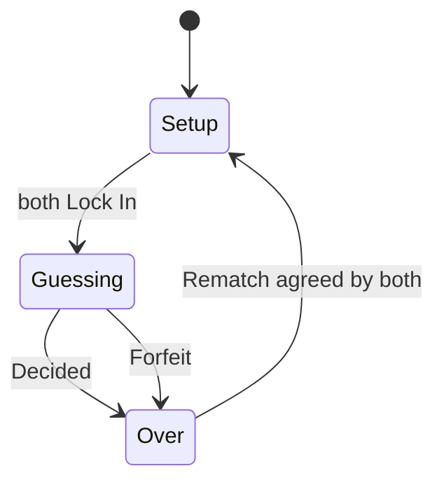

# MVP domain discovery

Decisions from domain discovery (2026-11-13). Vocabulary lives in [GLOSSARY.md](../../GLOSSARY.md), and the hard-to-reverse decisions are in [docs/adr/](../adr/). This is input for the specs, not a spec itself.

## Rules

- Codes have 4 Slots and use 6 Colors. Colors can repeat, Slots can't be empty, and a Game allows 10 Guesses.
- A Hint is an Exact count and a Near count. Near = sum over Colors of min(times in Guess, times in Secret Code), minus Exact.
- Every Color and Hint marker has a distinct symbol. This is always on.
- Duel Outcome: fewer Guesses to Crack wins. Same count is a Draw, and so is neither Player Cracking. Time never decides.
- A Duel ends the moment it is Decided. Secret Codes are revealed to both Players when it is Decided or Forfeited.
- During a Duel, each Player sees the opponent's Guesses and Hints against their own Secret Code, live.

## Series lifecycle

## Duel lifecycle (inside an Active Series)

## Edge rules

| Situation                                              | Result                                                                                                                                                                                                                             |
| ------------------------------------------------------ | ---------------------------------------------------------------------------------------------------------------------------------------------------------------------------------------------------------------------------------- |
| Leave during Guessing (not yet Decided)                | Leaver Forfeits. Series Closes.                                                                                                                                                                                                    |
| Leave during Setup or Over                             | Series Closes, no extra result.                                                                                                                                                                                                    |
| End when the opponent has been Away for 2 min or more  | Forfeit only if the Duel is in Guessing, not yet Decided, and the Away Player still has Guesses to make. Otherwise the Series Closes with no result, or, if the Away Player has already finished, the other Player keeps guessing. |
| The Away Player comes back before the End is processed | The End is refused.                                                                                                                                                                                                                |
| Both Players Away for 30 min                           | Series Expires with no result. A pending Rematch doesn't stop it.                                                                                                                                                                  |
| Both press Rematch at the same time                    | Counts as both agreeing.                                                                                                                                                                                                           |
| Rematch pending and a Player Leaves                    | Series Closes.                                                                                                                                                                                                                     |
| Score                                                  | Kept across Rematches, reconnects and refreshes. Reset when the Series Closes.                                                                                                                                                     |
| One Series per Guest                                   | An Open Series counts. Joining another Invite asks you to Leave the current one first.                                                                                                                                             |
| Starting a new Solo with one unfinished                | Asks for confirmation, then counts as a Loss and breaks the streak. Closing, refreshing or going offline doesn't count.                                                                                                            |
| Switching from a Duel to Solo                          | The Player is Away.                                                                                                                                                                                                                |
| Nickname                                               | 1-16 characters, not unique, locked while in a Series.                                                                                                                                                                             |
| Link to a Closed Series                                | "This Series has ended."                                                                                                                                                                                                           |
| Link to an Active Series, opened by a third person     | "This Series is full."                                                                                                                                                                                                             |

## MVP scope

**In:**

- Solo (offline, saved progress, Stats).
- Duel through an Invite, Rematch and running Score.
- Nicknames and guest identity.
- Color + symbol pegs.
- The Away, Leave and Expire rules above.

**Out:**

- Accounts, recovery across devices, friends, profiles, online stats.
- Difficulty or custom settings.
- Daily puzzle.
- Race, AI opponent, more than 2 Players, spectators.
- Notifications and play spread over hours.
- QR or typed room codes.
- Bad-word filter.
- Chat or emotes.
- Time limits, idle detection.

## Accepted consequences

- Forfeit outranks guess counts. A Player who used all 10 Guesses without Cracking still wins by Forfeit if the opponent is Away with Guesses left and gets Ended.
- An Invite works like a key: whoever Joins first gets the seat.
- Identity is tied to one browser. On iPhone, Safari, the installed home-screen app and in-app browsers (WhatsApp, Instagram) each have separate storage, so the same person can turn up as different Guests. Safari may also clear storage for sites that aren't installed after about 7 days without use, which loses Solo Stats.

## Implementation considerations (non-blocking)

- **Presence:** based on taking part in the Duel, not on being connected. Count the Duel screen being hidden, the app in the background, or the Player opening Solo. The server times Away periods from when it last heard from the Player.
- **Hint and Outcome rules:** one pure, shared module used by the device (Solo) and the server (Duel). It needs thorough tests for repeated Colors and early Decided detection.
- **Join:** never claim a seat when a page is loaded or the link is previewed. Join is an explicit action, and only one Join can win the seat.
- **Duplicate Guesses:** key each Guess by Player, Duel and Guess number, so a retry or double-tap can't add a second Guess.
- **Per-player views:** a Secret Code is never sent to the opponent until the Duel is Over.
- **Guest token:** random and non-guessable (128 bits or more), never derived from the Nickname. Render Nicknames as escaped text, and count their length in visible characters so emoji count once.
- **Realtime transport and hosting:** to be chosen in the architecture phase, as an ADR candidate. It needs reconnects after the phone backgrounds the app, and timers and expiry measured on the server. Standard serverless functions can't keep long-lived connections open.
- **Offline Solo:** an installed-app cache plus on-device storage for the game in progress and Stats.
- **Trademark:** never use "Mastermind" in the product, copy or metadata.
